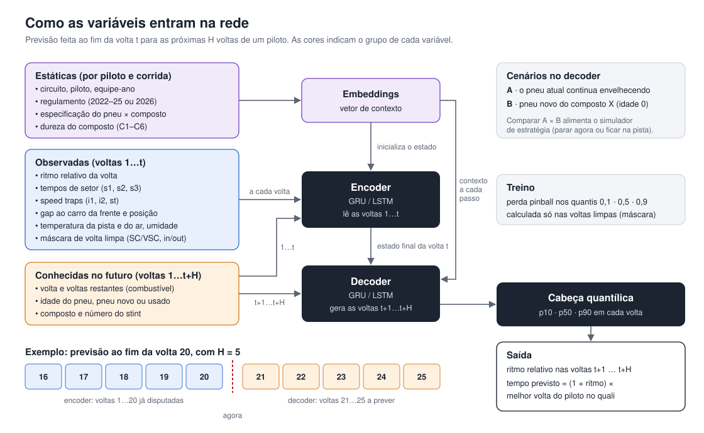

# Neural Stints

Previsão de ritmo de corrida e degradação de pneus na Fórmula 1 com redes neurais recorrentes (LSTM/GRU).

> Projeto final da disciplina **Redes Neurais 2**, do Bacharelado em Estatística da Universidade de Brasília (UnB). Em desenvolvimento.

## Motivação

Numa equipe de Fórmula 1, a estratégia de corrida depende de saber como o tempo de volta vai evoluir: quanto o carro ganha com um jogo de pneus novos, quanto perde à medida que o pneu envelhece e quando a degradação passa a custar mais do que uma parada nos boxes. Este projeto tenta responder isso com dados públicos e uma rede neural.

## O que a rede faz

A partir das voltas já disputadas por um piloto numa corrida, a rede prevê:

- **o ritmo das próximas voltas** dentro do stint atual;
- **a curva de desempenho do próximo stint** com um pneu novo de um dado composto: o aquecimento inicial, a degradação e a queda final de rendimento (*cliff*).

Cada previsão vem com um intervalo de incerteza (quantis p10, p50 e p90). Com essas curvas, é possível comparar cenários de estratégia, como "parar agora com o composto X" ou "ficar mais *k* voltas na pista".

## Abordagem



- **Arquitetura:** rede recorrente encoder–decoder (LSTM e GRU). O encoder lê a corrida até o momento; o decoder recebe o que já se sabe sobre as voltas futuras (idade do pneu, composto, voltas restantes) e prevê os tempos de volta.
- **Alvo:** ritmo relativo à melhor volta do piloto no treino classificatório, para comparar circuitos e temporadas diferentes.
- **Eras de regulamento:** os dados cobrem as temporadas de 2022 a 2026, que têm regulamentos técnicos e especificações de pneu diferentes. Em vez de um modelo por era, uma única rede é condicionada pelo regulamento, pela especificação do pneu e pela dureza do composto (C1 a C6).
- **Comparação:** os modelos são avaliados contra baselines estatísticos (média móvel, modelo linear misto e gradient boosting), com validação por corrida em ordem cronológica.

## Teste ao vivo

Além da avaliação com dados históricos, a rede é testada durante corridas reais. Um serviço em Python lê o estado da corrida de uma instância local do [f1-dash](https://github.com/slowlydev/f1-dash), que consome o feed oficial de live timing da F1, e gera as previsões a cada volta completada.

## Dados

| Fonte | Uso |
|---|---|
| [TracingInsights](https://github.com/TracingInsights) | Tempos de volta, compostos, idade dos pneus, clima e status de pista (2022–2026) |
| [OpenF1](https://openf1.org) | Voltas, stints e pit stops para checagem cruzada |
| [Jolpica F1](https://github.com/jolpica/jolpica-f1) | Tempos de volta oficiais para checagem cruzada |
| Pirelli / F1.com | Compostos nominados para cada Grande Prêmio |
| Live timing da F1, via f1-dash | Dados ao vivo durante as corridas |

Os dados brutos não ficam neste repositório. Cada fonte tem a sua própria licença ou termos de uso. Como baixar e organizar os dados está em [data/README.md](data/README.md).

## Como rodar

Requer Python 3.11 e git. A partir da pasta do repositório:

```bash
py -3.11 -m venv .venv
.venv/Scripts/python -m pip install -r requirements.txt
py pipeline/fetch_tracinginsights.py
.venv/Scripts/python -m pipeline.build_laps
.venv/Scripts/python -m pipeline.race_laps
.venv/Scripts/python -m pipeline.sequences
.venv/Scripts/python -m modeling.naive      # baseline ingênuo -> runs/naive_<data>/
.venv/Scripts/python -m modeling.gru        # GRU encoder–decoder -> runs/gru_<data>_s1/ (~2 min em CPU)
.venv/Scripts/python -m modeling.backtest   # relatório GRU × ingênuo (Austin e México) -> runs/gru_.../backtest.html
```

Durante uma sessão, com o f1-dash rodando (`realtime` em `localhost:4000`), três processos ficam no ar, cada um no seu terminal, gravando em `data/live/<ano>_<circuito>_<sessão>/`:

- o **gravador** salva o fluxo bruto em `recording.jsonl`, no formato do simulador do f1-dash (serve para o replay do projeto e para rever a sessão no próprio painel do f1-dash);
- o **leitor** monta o histórico de voltas em `laps.parquet` (e os dados da sessão em `session.json`);
- o **previsor** roda a GRU a cada volta nova e grava `predictions.parquet` no formato padrão, preenchendo o valor real de cada volta prevista quando ela termina. Só funciona em corridas e sprints, que têm total de voltas.

```bash
.venv/Scripts/python -m live.recorder                     # grava a sessão (SSE do f1-dash)
.venv/Scripts/python -m live.reader                       # ao vivo, lendo o f1-dash a cada 3 s
.venv/Scripts/python -m live.predict                      # previsões na corrida mais recente
.venv/Scripts/python -m live.reader --replay <gravação>   # reprodução de uma corrida gravada
.venv/Scripts/python -m live.history 2026_19              # confere: caminho ao vivo × pipeline numa corrida do treino
```

O painel tem três abas: **Ao Vivo** (a sessão atual pelo f1-dash, ou uma sessão gravada: cronometragem, tempos de volta e, na corrida, as previsões da GRU), **GRU v0** (métricas, gráficos e exemplos do modelo treinado contra o ingênuo) e **Tarefas A e B** (previsto × real para até dois pilotos: o ritmo nas k voltas depois do começo da corrida ou de uma parada, e o stint inteiro de um jogo de pneus, com a degradação real e a prevista):

```bash
.venv/Scripts/streamlit run dashboard/app.py              # http://localhost:8501
```

O cabeçalho mostra os logos da F1 e da UnB se os arquivos estiverem em `dashboard/assets/` (ver o README da pasta). Por serem marcas registradas, eles ficam fora do git.

Se o leitor for reiniciado no meio da sessão, ele retoma o histórico já gravado. O `live/history.py` transforma esse histórico nas variáveis do treino, usando as mesmas funções do pipeline.

No macOS ou Linux, use `python3` e `.venv/bin/python`.

## Organização

```
pipeline/   scripts de coleta e preparação dos dados
modeling/   modelos (baselines e redes) e cálculo das métricas
live/       leitura do live timing (f1-dash ou gravação), gravador, histórico e previsões ao vivo
dashboard/  painel Streamlit (abas Ao Vivo, GRU v0 e Tarefas A e B)
runs/       resultados de cada modelo treinado (fora do git)
data/       dados brutos, intermediários e de referência (ver data/README.md)
docs/       documentos e figuras do projeto
```

O formato dos resultados dos modelos e as métricas calculadas estão em [docs/resultados.md](docs/resultados.md). O que foi feito e decidido a cada dia está no [diário de desenvolvimento](docs/diario.md).

## Aviso

Projeto acadêmico e não oficial, sem qualquer vínculo com a Fórmula 1, a FIA, a Pirelli ou as equipes. Fórmula 1 e marcas relacionadas pertencem aos seus respectivos donos.

## Cronograma

Entrega prevista para o início de dezembro de 2026. Horários de Brasília. O GP de São Paulo recebe a primeira versão da rede ao vivo (v0, modelo simplificado); o GP de Las Vegas, a versão final (v1).

✅ concluído · 🔄 em andamento · ⏳ pendente · 🔴 teste ao vivo

*Atualizado em 5 de novembro de 2026.*

### Semana 1 · 2 a 8 de novembro · v0 em Interlagos

| Data | Atividade | Status |
|---|---|---|
| Seg 2 – Ter 3 | Sparse clone do TracingInsights 2022–2026 (tempos de volta, clima, race control) | ✅ |
| Seg 2 – Ter 3 | Atualização dos dados de 2026 até o GP do México | ✅ |
| Seg 2 – Ter 3 | Tabela de voltas, flags de limpeza, alvo relativo ao quali e sequências encoder/decoder | ✅ |
| Qua 4 | Baseline ingênuo (feito na quinta, 5/11) | ✅ |
| Qua 4 | GRU v0 (feita na quinta, 5/11) | ✅ |
| Qua 4 | Backtest em Austin e México (feito na quinta, 5/11) | ✅ |
| Qui 5 | Serviço ao vivo: leitura do f1-dash | ✅ |
| Qui 5 | Serviço ao vivo: histórico de voltas (retomada, voltas deletadas, variáveis do treino) | ✅ |
| Qui 5 | Serviço ao vivo: gravador das sessões | ✅ |
| Qui 5 | Serviço ao vivo: previsões da GRU sobre o histórico | ✅ |
| Qui 5 | Painel Streamlit: abas Ao Vivo e GRU v0 (antecipado das semanas 2 e 3) | ✅ |
| Sex 6 | Ensaio 1 no TL1 (12h30) e TL2 (16h00): validar a leitura dos dados ao vivo | ⏳ |
| Sáb 7 | Ensaio 2 no TL3 (11h30) e quali (15h00), que fornece a referência; congelar a v0 | ⏳ |
| Dom 8 | 🔴 **GP de São Paulo (14h00):** v0 ao vivo e gravação da corrida | ⏳ |

### Semanas 2 e 3 · 9 a 22 de novembro · v1 em Las Vegas

| Data | Atividade | Status |
|---|---|---|
| 9 – 15/11 | Compostos C1–C6 por GP; modelo linear misto e LightGBM; LSTM × GRU; previsão quantílica; experimento das eras de regulamento; avaliação da v0 em Interlagos | ⏳ |
| 16 – 19/11 | Congelar a v1; painel com o simulador de estratégia; ensaio por replay da gravação de Interlagos | ⏳ |
| Qui 19/11 | Ensaio no TL1 de Las Vegas (21h30) | ⏳ |
| Sex 20/11 | Ensaios no TL2 (01h00) e TL3 (21h30) | ⏳ |
| Sáb 21/11 | Quali (01h00), que fornece a referência | ⏳ |
| Dom 22/11 | 🔴 **GP de Las Vegas (01h00, sábado à noite):** v1 ao vivo e gravação da corrida | ⏳ |

### Semanas 4 e 5 · 23 de novembro até a entrega

| Data | Atividade | Status |
|---|---|---|
| 23 – 26/11 | Avaliação ao vivo (Interlagos × Las Vegas); backtest do simulador de estratégia contra as paradas reais | ⏳ |
| 27 – 29/11 | Ablação com telemetria (se houver tempo); figuras finais; redação do relatório | ⏳ |
| 30/11 – entrega | Revisão do relatório; apresentação com demonstração por replay | ⏳ |
