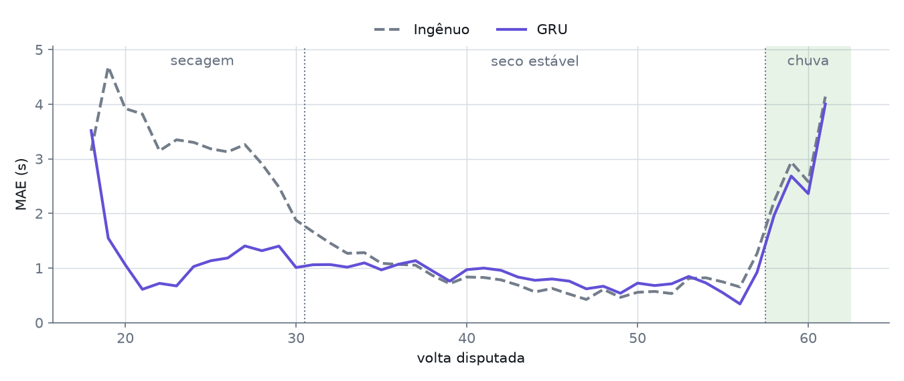
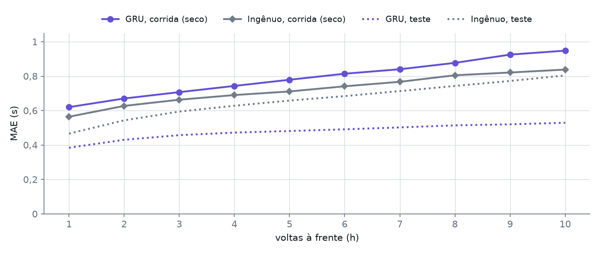
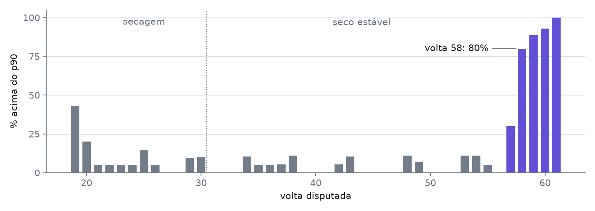
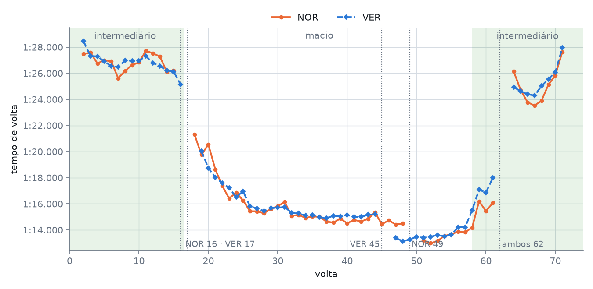
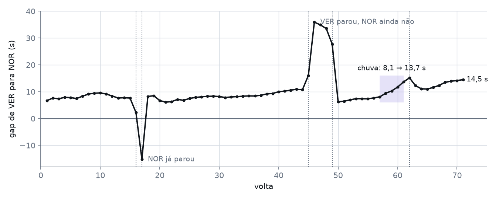
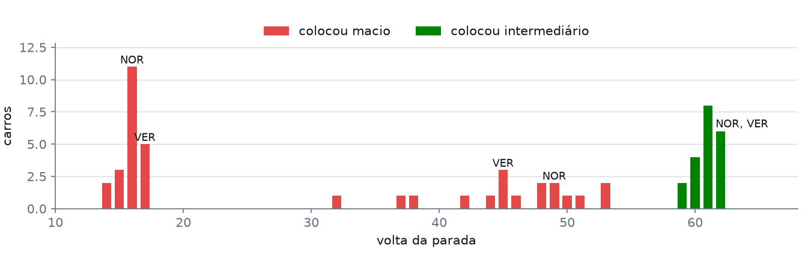
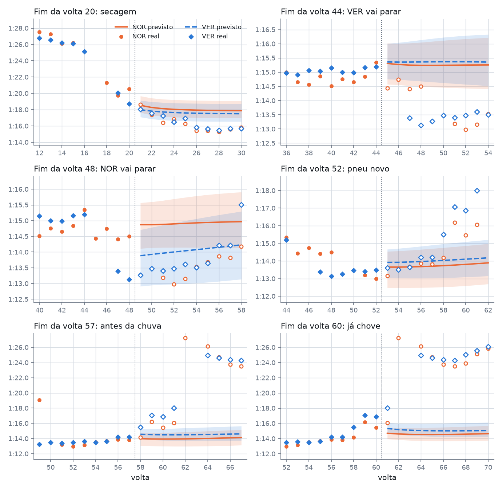
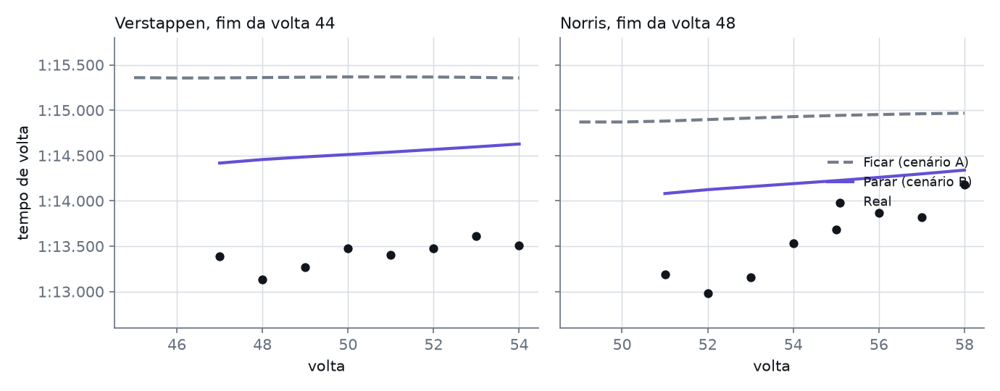

# Neural Stints em Interlagos

Relatório da primeira corrida real da GRU: GP de São Paulo, 8 de novembro de 2026, 71 voltas com pista molhada, seca e molhada de novo. As previsões foram feitas ao vivo, volta a volta, para as 10 voltas seguintes.

Eduardo Schneider Arruda · projeto final de Redes Neurais 2 · Bacharelado em Estatística, UnB

Modelo `gru_20261106_ens5` (média de 5 sementes) · 12.603 previsões · 1.435 voltas · 21 carros

A corrida com as previsões pode ser reproduzida na [demo do painel](https://schneiderweisse.github.io/Neural_Stints/), na aba Corridas gravadas.

## Resumo

- **Em voltas limpas de pneu liso, a rede errou 1,115 s em média, contra 1,534 s do ingênuo** (repetir a média das 3 últimas voltas). A vantagem de 27% é a mesma do conjunto de teste (0,476 × 0,655 s), com um erro absoluto 2,3 vezes maior.
- **O melhor momento foi a secagem** (voltas 17 a 30): 1,14 s contra 2,97 s. Quando o ritmo tem tendência forte, a rede acompanha e o ingênuo fica para trás.
- **Em seco estável o ingênuo venceu**, 0,70 s contra 0,76 s. A rede projetou tempos lentos demais (viés de +0,49 s), e a faixa p10–p90 cobriu 65% das voltas, contra 88% no teste.
- **Com pneu de chuva a rede não serve:** errou 9,6 s na largada e 11,7 s no final. Ela foi treinada sem corridas molhadas. A previsão nesses trechos não deveria nem aparecer no painel.
- **A rede avisou da chuva antes do feed.** Na volta 58, 80% do pelotão andou acima do p90 previsto (média de 4% antes disso). O aviso de chuva do feed só veio 6 minutos depois.
- **Norris × Verstappen foi decidido em 4 voltas.** Com a chuva caindo sobre pneu liso, Verstappen perdeu 1,39 s por volta e o gap foi de 8,1 para 13,7 s. A corrida terminou com 14,5 s.
- **Nas paradas, a rede acertou a direção e errou o tamanho:** previu ganho de 0,72 a 0,84 s por volta com pneu novo. O ganho real foi de 1,41 a 1,82 s.

## A corrida em cinco fases

| Fase | Voltas | Pneu | O que aconteceu |
|---|---|---|---|
| Intermediário | 2–16 | Intermediário | Largada com pista molhada. Primeiras trocas nas voltas 14–17. |
| Secagem | 17–30 | Macio | O tempo cai de 1:21 para 1:15. |
| Seco estável | 31–57 | Macio | Pneu macio do começo ao fim. Quase todos fazem uma segunda parada entre as voltas 32 e 53, em troca de outro jogo de macios. Único trecho parecido com o que a rede viu no treino. |
| Chuva | 58–62 | Macio | Chuva com os carros ainda de liso. |
| Intermediário | 63–71 | Intermediário | Final de novo molhado. |

## Precisão da rede

Cada linha compara a mediana prevista (p50) com o tempo real. **MAE** é o erro absoluto médio em segundos. **Viés** é previsto menos real: positivo significa que a rede previu mais lento do que aconteceu. **Cobertura** é a parte das voltas dentro da faixa p10–p90, que deveria ficar perto de 80%.

| Trecho | Previsões | MAE GRU (s) | MAE ingênuo (s) | Viés GRU (s) | Cobertura | Pinball (s) |
|---|---:|---:|---:|---:|---:|---:|
| **Visão geral: voltas limpas, pneu liso** | | | | | | |
| Toda a corrida | 7.661 | **1,115** | 1,534 | +0,430 | 49,8% | 0,377 |
| Alvo no mesmo stint da previsão | 6.572 | **1,057** | 1,536 | +0,401 | 52,0% | 0,353 |
| Alvo depois de uma parada | 1.089 | **1,463** | 1,507 | +0,604 | 36,6% | 0,524 |
| Conjunto de teste (Singapura, Austin, México) | 28.451 | 0,476 | 0,655 | +0,019 | 87,6% | 0,160 |
| **Por fase: alvo no mesmo stint** | | | | | | |
| Intermediário, largada (2–16) \* | 1.715 | 9,567 | **0,899** | −9,567 | 0,0% | – |
| Secagem (17–30) | 1.742 | **1,141** | 2,974 | +0,661 | 49,7% | 0,382 |
| Seco estável (31–57), previsão feita já nessa fase | 3.304 | 0,763 | **0,699** | +0,490 | 64,5% | 0,230 |
| Chuva em pneu liso (58–62) | 494 | **2,509** | 2,742 | −2,509 | 7,9% | 1,005 |
| Intermediário, final (63–71) \* | 771 | 11,694 | **4,664** | −11,694 | 0,0% | – |

O negrito marca o menor erro de cada linha. \* A máscara de voltas limpas do treino só aceita pneu liso, então as voltas de intermediário não entram nas métricas nem no "erro ao vivo" do painel. Nessas duas linhas uso todas as voltas válidas (com tempo, fora do box, sem SC e sem volta apagada), e o ingênuo repete a média das 3 últimas voltas válidas, sem filtro de pneu.

No ao vivo, a rede assume "mesmo pneu, sem parada", por isso a linha "depois de uma parada" mede um cenário que ela não conhecia. Dar a ela as paradas reais muda pouco: 1,115 → 1,107 s no total, e 1,463 → 1,401 s depois de parada.

*A rede ganha quando o ritmo muda e empata quando ele para de mudar. MAE por volta disputada, em todas as previsões que miravam aquela volta no mesmo stint.*

*Em seco estável, o erro cresce com o horizonte como no teste, mas partindo de um patamar mais alto. As curvas de teste incluem alvos depois de parada, então servem como referência de nível.*

### Por que a rede previu lento demais em seco

Em seco estável, 82% das voltas reais ficaram abaixo do p50 e 30% abaixo do p10. Testei quatro explicações.

| Hipótese | O que medi | Conclusão |
|---|---|---|
| Pneu macio muito velho, fora do treino | 19% das voltas limpas tinham 25 voltas de pneu ou mais (7% no treino). O viés fica entre +0,31 e +0,83 s até 35 voltas de idade, sem padrão crescente. | Não explica. |
| Referência vinda dos treinos livres (quali molhado) | Reescalei a referência pela razão histórica entre melhor volta de treino e de quali (1,0109, mediana de 2.048 casos) e marquei como vinda do quali. O viés cai de +0,49 para +0,43 s. | Explica pouco. |
| Tendência que a rede não projeta | As previsões do stint 2 de NOR e VER ficam quase planas (0,00 a +0,01 s por volta), enquanto o real caía 0,03 a 0,05 s por volta. O viés cresce de +0,34 s (h=1) para +0,74 s (h=10), cerca de 0,045 s por volta à frente. | Explica o crescimento com o horizonte. |
| Nível de ritmo atípico | O ritmo em seco ficou 4,1% acima da referência; a mediana do treino com referência de treino livre é 4,8%. A diferença de 0,7% equivale a cerca de 0,5 s por volta. A pista estava a 24 °C (mediana do treino: 36 °C) e o ar a 16 °C (25 °C). | Compatível com o viés já em h=1. A rede puxa para o nível típico. Não comprovado. |

**Uma correção simples não resolve.** Subtrair da previsão a média dos erros das últimas 3 voltas do stint melhora o seco desta corrida (0,858 → 0,726 s nas voltas 31–57), mas piora a validação (0,558 → 0,605 s) e o teste (0,465 → 0,537 s). Olhando só para esta corrida, eu teria adotado uma regra que faz mal às outras.

### A rede como detector de chuva

*Do lugar comum a quase todo o pelotão em duas voltas. Parte dos carros cuja volta real ficou acima do p90 previsto uma volta antes, só em pneu liso.*

Entre as voltas 31 e 56, em média 3,8% dos carros ultrapassaram o p90, com máximo de 11%. Na volta 57 foram 30%, e na 58, 80%. Norris fechou a volta 58 às 15:20:28. O aviso "LOW GRIP CONDITIONS" da direção de prova saiu às 15:24:40, e o feed só marcou chuva às 15:26:34. Depois da secagem, nenhuma volta da corrida passou de 11% antes disso. É uma única corrida, mas o sinal é forte e usa o que a rede já produz.

### Ritmo em k voltas

Para estratégia importa o tempo acumulado em várias voltas, mais do que cada volta isolada. Aqui o erro é medido na média das k voltas seguintes, com todas limpas e no mesmo stint.

| Fase da previsão | k | Previsões | MAE GRU (s) | MAE ingênuo (s) | Viés GRU (s) | Erro acumulado nas k voltas (s) |
|---|---:|---:|---:|---:|---:|---:|
| Secagem | 3 | 243 | **0,604** | 1,393 | +0,346 | 1,81 |
| Secagem | 5 | 233 | **0,688** | 1,639 | +0,556 | 3,44 |
| Secagem | 10 | 209 | **0,986** | 2,089 | +0,981 | 9,86 |
| Seco estável | 3 | 406 | 0,547 | **0,518** | +0,395 | 1,64 |
| Seco estável | 5 | 335 | 0,557 | **0,512** | +0,476 | 2,79 |
| Seco estável | 10 | 188 | 0,695 | **0,593** | +0,675 | 6,95 |

Em seco, médias mais longas quase não reduzem o erro da rede, porque o viés é sistemático e não se cancela. Sete segundos em 10 voltas equivalem a quase 30% do custo de uma parada aqui (24 a 25 s), o que já muda a conta de uma decisão de box.

## Estudo de caso: Norris × Verstappen

Os dois fizeram a mesma sequência de pneus: intermediário, macio, macio, intermediário. Norris largou na pole, caiu para 3º na largada e venceu. Verstappen largou em 21º, fechou a primeira volta em 13º e terminou em 2º, 14,6 s atrás. Antes da primeira parada ele já estava em 5º, perdendo só 1 s para Norris em 14 voltas enquanto passava carros.

*Ritmo real. As voltas de entrada e saída do box ficam fora do gráfico; as linhas pontilhadas marcam as paradas.*

*Gap de Verstappen para Norris. Os picos são as paradas em voltas diferentes. Calculado pela soma dos tempos de volta; no fim fica a 0,12 s do valor do feed.*

### Ritmo por stint e por trecho

| Stint | Voltas NOR | Voltas VER | Média NOR | Média VER | NOR × pelotão (s) | VER × pelotão (s) |
|---|---|---|---:|---:|---:|---:|
| 1º, intermediário | 1–16 | 1–17 | 1:26.847 | 1:26.800 | −1,60 | −1,54 |
| 2º, macio | 17–49 | 18–45 | 1:15.880 | 1:15.978 | −1,01 | −0,93 |
| 3º, macio novo | 50–62 | 46–62 | 1:14.192 | 1:14.452 | −1,50 | −1,05 |
| 4º, intermediário | 63–71 | 63–71 | 1:25.079 | 1:25.355 | −1,48 | −1,20 |

Médias nas voltas válidas. "× pelotão" é a diferença para a mediana dos carros com o mesmo pneu na mesma volta, o que remove pista, combustível e clima.

| Trecho, voltas em que os dois têm volta válida | Voltas | NOR | VER | VER − NOR por volta (s) |
|---|---:|---:|---:|---:|
| Intermediário, largada (2–15) | 14 | 1:26.847 | 1:26.919 | +0,07 |
| Macio na secagem (19–30) | 12 | 1:16.950 | 1:16.949 | 0,00 |
| Macio em seco (31–44) | 14 | 1:14.965 | 1:15.145 | +0,18 |
| Ambos de macio novo (51–57) | 7 | 1:13.460 | 1:13.723 | +0,26 |
| **Chuva em pneu liso (58–61)** | 4 | 1:15.471 | 1:16.864 | **+1,39** |
| Intermediário, final (65–71) | 7 | 1:24.929 | 1:25.416 | +0,49 |

### As paradas

| Parada | Volta | Idade do pneu | Posição antes → depois | Perda no box (s) | Ritmo antes → depois | Gap VER − NOR antes |
|---|---:|---:|---|---:|---|---:|
| NOR intermediário → macio | 16 | 16 | 2º → 3º | 23,9 | 1:26.79 → 1:20.54 | +7,65 |
| VER intermediário → macio | 17 | 17 | 3º → 4º | 22,2 | 1:26.01 → 1:18.94 | +2,26 |
| VER macio → macio | 45 | 28 | 2º → 5º | 24,2 | 1:15.09 → 1:13.26 | +10,74 |
| NOR macio → macio | 49 | 33 | 1º → 3º | 25,0 | 1:14.52 → 1:13.11 | +33,55 |
| NOR macio → intermediário | 62 | 13 | 1º → 1º | – | 1:15.47 → 1:24.87 | +13,65 |
| VER macio → intermediário | 62 | 17 | 2º → 2º | – | 1:16.86 → 1:24.65 | +13,65 |

Perda no box: entrada + saída menos duas vezes o ritmo das 3 voltas anteriores. Na troca para intermediário a conta não vale, porque o ritmo de referência mudou com a chuva. O feed não traz o tempo de pit lane, então não dá para separar o pit stop da volta de saída.

*Três ondas de paradas. Número de carros que pararam em cada volta, pelo pneu que colocaram.*

> **Sobre o raciocínio das equipes:** o que segue é inferência a partir dos dados. Procurei declarações das equipes no dia da corrida e não encontrei nenhum relato da edição de 2026, só a cobertura da de 2025. Os trechos em itálico são a leitura mais provável, e não o que McLaren ou Red Bull disseram. O rádio não ajuda: o feed só traz o link do áudio, sem transcrição, e não baixei os áudios.

#### 1ª parada: quando trocar de intermediário para liso

**Dados.** Hamilton e Sainz trocaram primeiro, na volta 14. Na volta 16, a primeira cronometrada de macio, Hamilton fez 1:26.16, contra mediana de 1:26.87 dos carros de intermediário. Na volta seguinte fez 1:22.35: o cruzamento já tinha acontecido. Onze carros pararam na volta 16, Norris entre eles. Verstappen ficou mais uma volta, fez 1:25.135 (a melhor volta dele de intermediário) e parou na 17, como Antonelli, que liderava.

**Raciocínio provável.** *Norris, em 2º e 7,0 s atrás de Antonelli, viu o tempo do primeiro carro de macio e parou uma volta antes do líder para tentar o undercut. Verstappen, vindo de trás, aproveitou a pista livre enquanto os outros entravam no box e subiu para 2º antes de parar.*

**Resultado.** O undercut funcionou: na volta 18, Norris estava a menos de 1 s de Antonelli. Na volta 20, Antonelli errou na curva 1 (tempo apagado por limite de pista) e Norris assumiu a liderança, que só cedeu nas paradas. Para Verstappen, esperar uma volta custou pouco: 0,9 s para Norris e 0,8 s para Hadjar entre as voltas 15 e 19.

**O que a rede via.** Nada de útil. Ao fim da volta 15 ela previa 1:19.8 para a volta seguinte, e Norris fez 1:30.5, volta de entrada no box; a volta de intermediário comparável estava na casa de 1:26. Estava fora do domínio do treino.

#### 2ª parada: undercut de um lado, cobertura do outro

**Dados.** Verstappen era 2º, 10,7 s atrás, e perdia 0,30 s por volta para Norris entre as voltas 38 e 44. Hadjar, companheiro de equipe, vinha a 0,48 s atrás dele. Hülkenberg parou na volta 44; Lindblad, Sainz e Verstappen na 45. Norris ficou mais 4 voltas: na 48, tinha 33,5 s sobre Verstappen, que tirava de 1,0 a 1,4 s por volta.

**Raciocínio provável.** *Verstappen não ia alcançar Norris na pista, e tinha Hadjar colado atrás. Parar primeiro era a forma de atacar um e se proteger do outro. Na conta, com o ganho medido depois: 1,82 s por volta e 24,2 s de custo pagam a parada em cerca de 13 voltas, e ainda havia 25 pela frente. Norris podia esperar, porque tinha folga sobre o custo do box. Parou com 6,3 s de margem, sem usar toda a folga, o que também protege de um pit stop lento e deixa o pneu dele 4 voltas mais novo que o de Verstappen.*

**Resultado.** O undercut deu resultado parcial: a diferença para Norris caiu de 10,7 para 7,4 s (volta 54), sem chegar perto. Contra Hadjar, foi um sucesso: de 0,6 s para 8,7 s de vantagem na volta 54. Norris voltou em 3º e retomou a ponta na volta 54, depois que Hadjar (volta 50) e Antonelli (volta 53) pararam.

**Foi preciso parar?** Não pelo pneu. Russell e Leclerc não fizeram esta parada e seguiram até a volta 61, com 45 voltas no macio. Russell só ficou 0,15 s por volta mais lento entre os trechos 38–44 e 51–57. O gap de Norris para ele foi de 37,8 s (volta 44) para 33,9 s no fim, então a parada extra custou cerca de 4 s a Norris, com a chuva encurtando o tempo de pagar o investimento. Russell saiu de 7º na volta 44 para 4º no fim.

#### 3ª parada: até quando ficar de liso na chuva

**Dados.** A pista piorou por partes. A mediana do pelotão no setor 1 subiu de 19,45 s para 20,17 s na volta 58, e a do setor 2, de 38,72 s para 40,19 s, com o setor 3 estável em 16,5 s. Câmara e Pérez, no fim do pelotão, pararam na volta 59. Na volta 61, os carros de intermediário ainda faziam 1:28.79, contra 1:18.12 dos de macio. Na volta 62, Norris fez o setor 1 em 24,06 s (3,3 s pior que na volta anterior) e entrou no box, assim como Verstappen.

**Raciocínio provável.** *Com o liso ainda 10 s por volta mais rápido, parar cedo só fazia sentido para quem não tinha nada a perder. Os líderes esperaram o sinal claro, que veio no setor 1 da volta 62. Norris tinha 13,7 s de vantagem, menos que o custo de um box: precisava parar junto com Verstappen ou depois dele, nunca antes, e parar na mesma volta eliminou o risco.*

**Resultado.** Aqui a corrida se decidiu, antes mesmo das paradas. Entre as voltas 57 e 61 o gap foi de 8,1 para 13,7 s. A diferença ficou quase toda no setor 2 (0,8 a 1,0 s por volta), e o pneu de Verstappen tinha 4 voltas a mais. Saber se foi o pneu, a pilotagem ou a chuva chegando em outro ponto da pista exige telemetria ou imagens, que não temos. De intermediário, Verstappen tirou 4 s nas primeiras voltas (a volta de saída dele foi 2,9 s mais rápida), mas Norris voltou a abrir até os 14,5 s finais.

**O que a rede via.** Previsão plana: ao fim da volta 57, 1:13.99 para Norris e 1:14.56 para Verstappen nas voltas seguintes. Ela reagiu devagar, subindo cerca de 0,2 s por volta, e o real ficou fora do p90 a partir da volta 59 para Norris e da 58 para Verstappen. Ela não prevê a chuva, mas mostra que algo mudou.

### As projeções da rede para os dois

*O que a rede projetava em seis momentos. À esquerda da linha pontilhada está o que ela já tinha visto; à direita, a mediana, a faixa p10–p90 e, em marcadores vazios, o que aconteceu de fato. Na [demo do painel](https://schneiderweisse.github.io/Neural_Stints/) dá para ver qualquer outra volta, com a comparação entre os dois pilotos.*

| Piloto, voltas limpas de pneu liso | MAE GRU, corrida (s) | MAE ingênuo, corrida (s) | MAE GRU, seco (s) | MAE ingênuo, seco (s) | Viés GRU, seco (s) | Cobertura, seco |
|---|---:|---:|---:|---:|---:|---:|
| Norris | **1,052** | 1,249 | 0,562 | **0,448** | +0,527 | 77,1% |
| Verstappen | **1,021** | 1,265 | **0,417** | 0,442 | +0,378 | 97,3% |

Em seco estável, Verstappen foi o piloto mais bem previsto dos 20 (0,417 s) e Norris o segundo; o pior foi Bearman (1,133 s). A diferença não vem do tráfego: o erro com outro carro a menos de 1,5 s (0,746 s) é igual ao de pista livre (0,767 s).

### A rede como estrategista: ficar ou parar

Ao vivo a rede só projetou "mesmo pneu, sem parada". Depois da corrida, rodei o mesmo modelo nas vésperas da 2ª parada de cada um, informando um pneu macio novo na volta seguinte. Isso permite comparar os dois cenários com o que aconteceu.

*A rede enxerga o ganho do pneu novo, mas estima a metade do real. Sem as voltas de entrada e saída, que não têm tempo comparável e ficam fora do treino.*

| Decisão | Ganho previsto (s/volta) | Ganho real (s/volta) | Custo do box (s) | Voltas úteis restantes | Valor pela rede (s) | Valor sem chuva, ganho real (s) | Valor com a chuva, ganho real (s) |
|---|---:|---:|---:|---:|---:|---:|---:|
| VER, fim da volta 44 | 0,84 | 1,82 | 24,2 | 25 | −3,2 | +21,3 | +3,1 |
| NOR, fim da volta 48 | 0,72 | 1,41 | 25,0 | 21 | −9,9 | +4,6 | −9,5 |

Valor = ganho por volta × voltas úteis − custo do box. "Com a chuva" conta só as voltas de pneu novo até a volta 61 (15 para VER, 11 para NOR). É uma estimativa: a rede só prevê 10 voltas e aqui estendo o ganho até o fim, sem desconto pelo desgaste do pneu novo. A rede também não sabe o custo do box, que entrou como número medido nesta corrida. Pela conta, Norris teria perdido cerca de 9,5 s; a comparação direta com Russell, que não parou, mostra cerca de 4 s.

## Como relacionar ritmo, pneu, stint, k voltas e paradas

O tempo de volta mistura piloto, pista, combustível, pneu e tráfego. A forma de relacionar tudo é separar esses efeitos em camadas, cada uma respondendo a uma pergunta, e só então entrar com a decisão de box. Abaixo está cada camada com o que ela mostrou nesta corrida.

| Pergunta | Medida | Nesta corrida |
|---|---|---|
| Quem foi mais rápido, tirando pista e clima? | Diferença para a mediana dos carros com o mesmo pneu na mesma volta. | NOR foi 0,08 s melhor que VER contra o pelotão no 2º stint e 0,45 s melhor no 3º. |
| Quanto o pneu realmente perde por volta? | `tempo = piloto + volta + β · idade + erro`, em regressão com efeitos fixos. O efeito de volta absorve pista e combustível; β se identifica porque carros com pneus de idades diferentes correm na mesma volta. | β = 0,042 s por volta (IC 95%: 0,029 a 0,056; 502 voltas, bootstrap por piloto), com efeito de volta de −0,049 s. Por isso o stint parece plano: um efeito cancela o outro. Um macio de 33 voltas custa 1,4 s, igual ao ganho medido de NOR (1,41 s). |
| Como é um stint? | Três trechos: aquecimento, queda linear e queda brusca. Comparar nível e inclinação do real com o previsto, por stint. | Nenhuma queda brusca em 45 voltas de macio, com pista a 24 °C. Inclinação no stint 2: real −0,05 (NOR) e −0,03 (VER); prevista +0,01 e 0,00. |
| Como está o ritmo em k voltas? | Média das próximas k voltas e erro acumulado. A média reduz o ruído, mas não o viés; a soma é o que se compara com o custo do box. | Em seco, a rede erra 7 s em 10 voltas por viés, quase 30% de um box. Na secagem, 1 s por volta contra 2,1 s do ingênuo. |
| Vale parar agora? | `V(L) = Σ (A − B) − custo do box`: soma da diferença entre ficar (A) e parar na volta L (B). Ponto de equilíbrio: custo ÷ ganho por volta. | Equilíbrio em 13 voltas (VER) e 18 (NOR). A rede dá A e B com incerteza; o custo vem de fora. |
| E contra o rival? | Para cada par de voltas de parada (L₁, L₂), projetar o gap final. O undercut vira a diagonal dessa matriz. | VER parou 4 voltas antes e tirou 3,4 s de NOR. NOR tinha margem para esperar até cerca de 4 voltas a mais. |
| O cenário mudou? | Parte do pelotão acima do p90 e variação por setor, volta a volta. | Alarme na volta 58, 6 min antes do aviso de chuva do feed. Setores 1 e 2 pioraram antes do 3. |

Duas extensões usam a experiência com modelos mistos do `regs_analyzer`. A regressão acima pode virar `lmer(tempo ~ idade * composto + (1 | volta) + (1 + idade | piloto) + (1 | piloto:stint))`, que dá a cada piloto a própria degradação com incerteza e aproveita mais de uma corrida. Hoje as estimativas por piloto (0,048 para NOR, 0,073 para VER) são pontuais e não têm intervalo, então ainda não dá para dizer que um cuida melhor do pneu que o outro.

A outra é usar esse modelo como conferência da rede: se a GRU projeta 0,84 s de ganho com pneu novo e o modelo misto indica 1,4 s, a divergência é um aviso útil ao vivo.

## O que muda para Las Vegas

- **Esconder a previsão com pneu de chuva.** Mostrar "fora do domínio do modelo" no lugar de um número errado em 10 s.
- **Separar as métricas por fase no painel.** O "erro ao vivo" atual só conta voltas limpas de pneu liso e mistura secagem, seco e chuva.
- **Colocar o alarme do p90 no painel.** É o resultado mais barato de levar para o ao vivo, porque só usa o que a rede já produz. Precisa ser verificado nas outras corridas para medir alarmes falsos.
- **Mostrar o cenário B ao vivo.** A coluna de cenário já existe no formato de resultados. Falta a perda no box por circuito.
- **Atacar o viés no treino, e não depois.** Testar uma entrada com a tendência recente do pelotão, avaliada na validação. Pista fria é um risco repetido: Las Vegas tende a ser fria também.
- **Recalibrar a faixa.** Testar intervalos conformais adaptativos, que alargam quando a cobertura recente cai. Testar também em validação e teste, pelo que aconteceu com a correção da mediana.
- **Tratar leituras impossíveis do feed.** O feed marcou pista a 0,0 °C às 14:25, e esse valor entrou como variável em 15 registros, nas voltas 15 e 16.

## Limites deste relatório

- É uma corrida só, com condições raras. Os números não generalizam, e o conjunto de teste continua sendo a medida do modelo em pista seca.
- O raciocínio das paradas é inferência. Sem declarações das equipes, rádio transcrito ou tempo de pit lane, não dá para confirmar os motivos.
- A regressão de efeitos fixos usa só as voltas limpas de 31 a 57. A idade do pneu se separa da volta porque os carros pararam em voltas diferentes, e voltas em tráfego não têm tratamento especial.
- Os cenários A × B foram rodados depois da corrida, com o mesmo modelo e só com dados disponíveis naquele momento. A volta de entrada e a de saída não têm previsão confiável.
- A primeira volta de cada carro não tem tempo no feed. O gap entre os pilotos parte do gap do feed ao fim da volta 1.

---

Dados: gravação ao vivo do feed de timing da F1 por um f1-dash local, em `data/live/2026_interlagos_race` (fora do git). Previsões: `predictions.parquet`, feitas durante a corrida. Projeto acadêmico e não oficial, sem vínculo com a Fórmula 1 ou a FIA.
